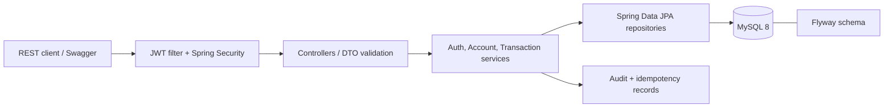
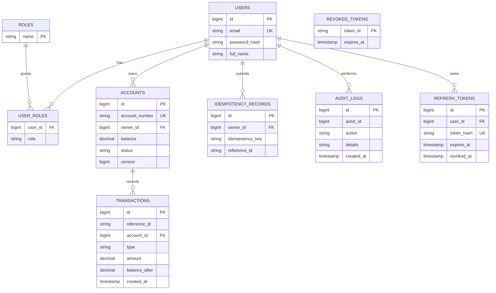
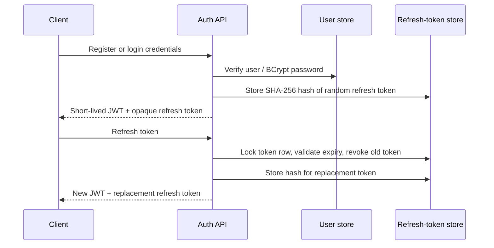
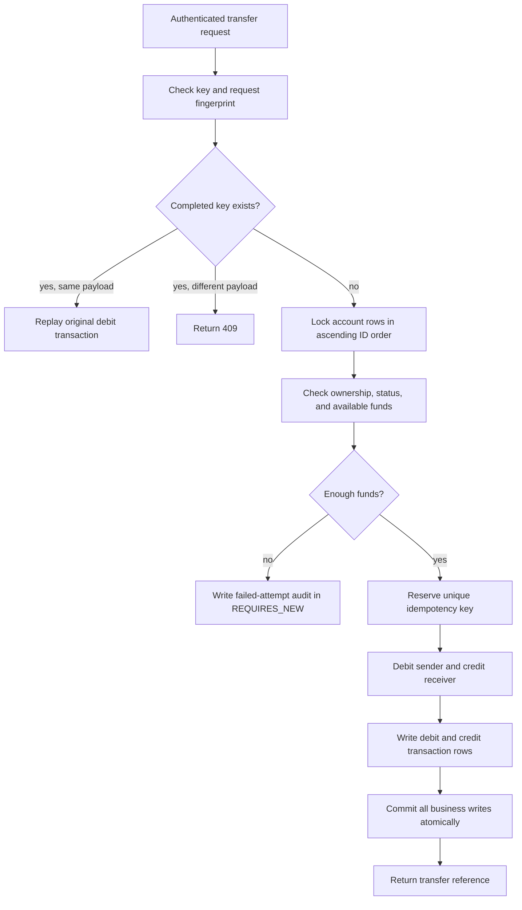

# Secure Banking & Transaction Management System

## Web frontend

The separate React application lives in `frontend/`. Install Node.js 20.19+ or 22.12+ and run:

```powershell
cd frontend
Copy-Item .env.example .env
npm install
npm run dev
```

Open `http://localhost:5173`; the API base defaults to `http://localhost:8080` and can be changed with `VITE_API_BASE_URL`. Start the backend and MySQL separately (or with `docker compose up --build`). Browser CORS is configured for `http://localhost:5173` by default. Set `APP_CORS_ALLOWED_ORIGINS` to a comma-separated list of trusted frontend origins when deploying; never use `*` for a public deployment. The client uses in-memory access and rotating refresh tokens, so reloading the page ends the browser session and requires signing in again.

Frontend checks: `cd frontend; npm run build` (type-checks with TypeScript and creates the Vite production bundle); `npm run lint` runs the TypeScript check. API behavior still requires a running backend and MySQL database.

A Java 17 / Spring Boot REST backend demonstrating account ownership controls, JWT authentication, relational persistence, and transaction-safe money movement. The implementation keeps money in `BigDecimal`, protects transfers with ordered pessimistic row locks, and stores transfer idempotency keys in MySQL.

> This is an interview/demo project, not a production banking platform. In particular, deposits are exposed as a demo funding operation; a real deployment must reconcile deposits against an external payment/cash ledger.

## Features

- BCrypt password hashing, short lived signed JWT access tokens, one time opaque refresh tokens stored as hashes, and database backed logout revocation.
- Customer registration/login and role protected admin APIs (ADMIN role assignment is an operator/database provisioning step).
- Multiple accounts per customer, random unique account numbers, account status changes, and owner checks on private account and transaction reads.
- Deposits, withdrawals, and atomic transfers, with nonnegative balance checks, `@Transactional`, deterministic lock ordering, and idempotency keys.
- Immutable transaction rows, paged history with date/type filters, opening/closing account statements, audit events, MySQL 8 and Flyway schema migrations.
- Admin user search, paged transaction search, status management, aggregate counts, and a configurable high-value transfer review heuristic.
- Request validation, consistent error bodies, Swagger UI, Docker Compose, unit tests, and MySQL Testcontainers integrity tests.

## Architecture



### Data model



### Authentication flow



### Transfer workflow



Any runtime failure in the transfer transaction is rolled back. The failure audit uses a separate transaction so that it survives the business rollback when MySQL is available.

Transfer writes both sides and the idempotency record in one DB transaction. The sender and receiver rows are locked in ascending ID order, which avoids a lock-order cycle between concurrent opposite-direction transfers. The unique `(owner_id, idempotency_key)` constraint is the final concurrency guard.

A retry after a successful transfer returns the original debit transaction when the key and payload match. If identical requests overlap before either commits, one succeeds and the other may receive `409 Conflict`; retrying after the first commit returns the stored result. Reusing a committed key with a different payload returns `409`.

## Requirements and quick start

Install Docker with Compose, or Java 17, Maven 3.9+, and MySQL 8.

```bash
cp .env.example .env
# Set JWT_SECRET to a random value of at least 32 bytes before starting.
docker compose up --build
```

In PowerShell, use `Copy-Item .env.example .env` instead of `cp`. Edit all three required secrets in `.env` before starting Compose.

The API listens on `http://localhost:8080`; Swagger UI is `http://localhost:8080/swagger-ui.html`. Compose starts MySQL, waits for its health check, and Flyway applies `src/main/resources/db/migration` during app startup.

For local Maven execution, start MySQL and set `DB_URL`, `DB_USERNAME`, `DB_PASSWORD`, and `JWT_SECRET`, then run:

```bash
mvn clean verify
mvn spring-boot:run
```

`.env.example` values are placeholders; replace them with local values and never reuse them in deployed environments. Compose requires `MYSQL_PASSWORD`, `MYSQL_ROOT_PASSWORD`, and `JWT_SECRET`. `application.yml` requires the database URL, database username/password, and JWT secret to be supplied through environment variables.

PowerShell example (replace the sample password and JWT secret):

```powershell
$env:DB_URL = 'jdbc:mysql://localhost:3306/banking?useSSL=false&allowPublicKeyRetrieval=true&serverTimezone=UTC'
$env:DB_USERNAME = 'banking'
$env:DB_PASSWORD = 'your-local-database-password'
$env:JWT_SECRET = 'replace-with-a-random-secret-of-at-least-32-bytes'
mvn clean verify
mvn spring-boot:run
```

## API overview

All private routes require `Authorization: Bearer <access-token>`. Registration and login are public. Use **Try it out** in Swagger, authorize with the access token, or import `postman/Secure-Banking.postman_collection.json`.

| Method | Path | Purpose |
| --- | --- | --- |
| POST | `/api/v1/auth/register` | Register CUSTOMER |
| POST | `/api/v1/auth/login` | Obtain access token |
| POST | `/api/v1/auth/refresh` | Rotate refresh token and issue a new access token (`{"refreshToken":"..."}`) |
| POST | `/api/v1/auth/logout` | Revoke current bearer and provided refresh token (`{"refreshToken":"..."}`) |
| POST / GET | `/api/v1/accounts` | Create / list own accounts |
| GET | `/api/v1/accounts/{id}` | Read owned account |
| GET | `/api/v1/accounts/{id}/balance` | Read owned balance |
| GET | `/api/v1/accounts/{id}/statement?from=...&to=...&page=0&size=100` | Owned statement with opening/closing balances and paged entries |
| POST | `/api/v1/transactions/deposit` | Demo deposit |
| POST | `/api/v1/transactions/withdraw` | Withdraw from owned account |
| POST | `/api/v1/transactions/transfer` | Transfer; requires `Idempotency-Key` header |
| GET | `/api/v1/transactions/history?accountId=1&page=0&size=20&from=...&to=...&type=DEPOSIT` | Owned account history |
| GET | `/api/v1/transactions/{id}` | Read owned transaction |
| GET | `/api/v1/admin/users?q=customer&page=0&size=50` | Search and page admin-visible users by email or name |
| GET | `/api/v1/admin/accounts` | Admin account listing |
| GET | `/api/v1/admin/transactions` | Admin transaction listing |
| GET | `/api/v1/admin/transactions/suspicious?minAmount=10000.00&since=...` | Heuristic high-value transfers for manual review |
| GET | `/api/v1/admin/transactions/suspicious?minAmount=10000.00&since=...` | High-value transfer review heuristic; not automated fraud detection |
| GET | `/api/v1/admin/statistics` | Admin counts for users, accounts, and transaction types |
| PATCH | `/api/v1/admin/accounts/{id}/status` | Admin status update (`ACTIVE`, `FROZEN`, `CLOSED`) |

Error responses have `timestamp`, `status`, `error`, `message`, and `path`. Sensitive server exceptions are intentionally returned as a generic 500 response. Import the Postman collection, run Register or Login, then create both accounts and fund the sender before Transfer. For admin requests, provision an operator as described below, run **Admin login**, and the collection stores the access token in `adminToken`.

### Example workflow

```bash
curl -X POST http://localhost:8080/api/v1/auth/register -H 'Content-Type: application/json' \
  -d '{"email":"customer@example.com","password":"change-this-password","fullName":"Example Customer"}'
curl -X POST http://localhost:8080/api/v1/auth/login -H 'Content-Type: application/json' \
  -d '{"email":"customer@example.com","password":"change-this-password"}'
curl -X POST http://localhost:8080/api/v1/accounts -H 'Authorization: Bearer <token>'
curl -X POST http://localhost:8080/api/v1/transactions/deposit -H 'Authorization: Bearer <token>' -H 'Content-Type: application/json' \
  -d '{"accountId":1,"amount":100.00,"description":"Demo funding"}'
curl -X POST http://localhost:8080/api/v1/transactions/transfer -H 'Authorization: Bearer <token>' -H 'Idempotency-Key: order-123' -H 'Content-Type: application/json' \
  -d '{"fromAccountId":1,"toAccountId":2,"amount":25.00,"description":"Example"}'
```

## Project layout

```text
src/main/java/com/example/banking/{config,controller,dto,entity,exception,repository,security,service}
src/main/resources/application.yml
src/main/resources/db/migration/V1__initial_schema.sql
src/test/java/com/example/banking/service
src/test/java/com/example/banking/TransactionIntegrityIT.java
postman/Secure-Banking.postman_collection.json
```

## Database and role provisioning

Flyway creates normalized `users`, `roles`, `user_roles`, `accounts`, `transactions`, `idempotency_records`, `audit_logs`, `refresh_tokens`, and `revoked_tokens` tables. No admin account or password is seeded. After creating an operator account, provision the role through a controlled DBA process, for example:

```sql
INSERT INTO user_roles(user_id, role) SELECT id, 'ADMIN' FROM users WHERE email='operator@example.com';
```

## Tests and limitations

Run `mvn clean verify` to compile and execute JUnit unit tests and MySQL Testcontainers integration tests. The integration suite is configured to skip if Docker is unavailable. Integration cases cover token rotation, logout revocation, access restrictions, failed-transaction auditing, database rollback, concurrent spending, and concurrent duplicate idempotency keys. Failed transaction audit records use an independent `REQUIRES_NEW` transaction; persistence still depends on MySQL being available. The refresh-token table stores only SHA-256 hashes of random 256-bit opaque tokens, rotates each token once, and cleans expired records hourly. The high-value transfer endpoint is a review aid, not a fraud classifier. No Redis, Kafka, rate limiting, or production deposit rail is included.

## Future improvements

- Refresh-token family replay response, rate limiting, account recovery, and administrative bootstrap tooling.
- Transfer limits, reconciliation, and payment provider integration.
- Run multi-node transfer load tests and review operational retention/monitoring policies.
- Statement export, paged admin user/account listings, and optional event publication through an outbox.

## Screenshots

Add Swagger UI and database migration screenshots here after running the service locally.

## Interview discussion prompts

- Why do transfers lock both account rows in ascending ID order, and what invariant does the database transaction preserve?
- How does the request fingerprint prevent accidental reuse of an idempotency key for a different transfer?
- Why are refresh tokens opaque and stored as hashes, and what does rotation protect against?
- How do owner checks in account and transaction services prevent IDOR access even when callers guess record IDs?
- Why does failed-transaction auditing use `REQUIRES_NEW`, and what happens if the database itself is unavailable?
- What ledger, reconciliation, rate-limiting, and operational controls would be needed before connecting a real payment rail?
